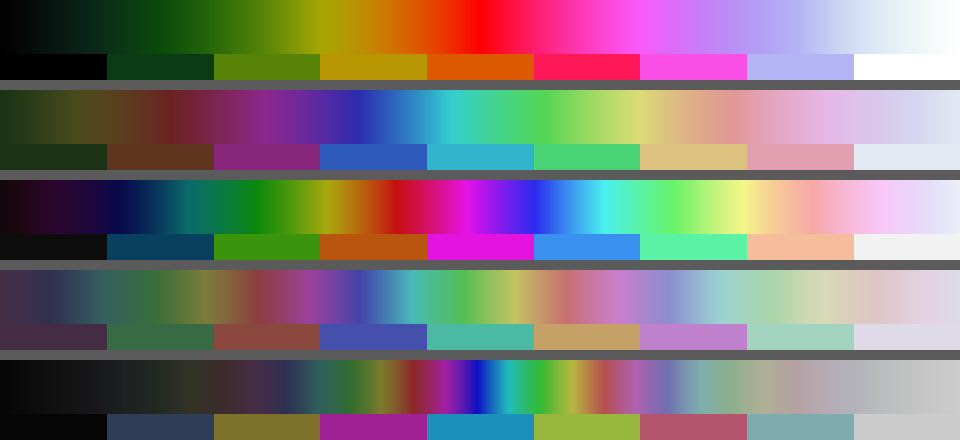
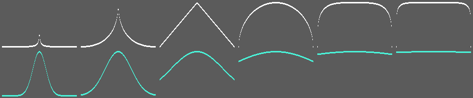

<div align="center">

# Parametric Curves in Color Space

**A colour gradient is a trajectory through the HSL solid.**
Travel along a curve and the colours you pass are a gradient; stop *n* times along the way and they are a palette.

### [**▶&nbsp; Open the lab**](https://cheque.github.io/color-curves/) &nbsp;·&nbsp; [**◆&nbsp; Palette picker**](https://cheque.github.io/color-curves/widget.html) &nbsp;·&nbsp; [**📄&nbsp; The paper**](https://archive.bridgesmathart.org/2023/bridges2023-181.html)



<sub>Five curves, and the nine colours sampled from each.</sub>

</div>

---

## The idea

Picking a palette usually means picking colours one at a time and hoping they agree. This tool starts somewhere else: it treats the HSL colour solid as a space you can *draw a line through*.

The HSL model is a cylinder. Hue is the angle around it, saturation the distance from the axis, lightness the height. Any curve inside that cylinder is therefore a continuous run of colour — and if the curve is smooth, the colours vary smoothly in all three attributes at once. No control points, no interpolation between chosen endpoints: the gradient falls out of the geometry.

Because the gradient is continuous, a palette is just a sampling of it. **Asking for twelve colours instead of seven is not a different palette — it is the same curve, sampled finer.** Palettes made this way extend, resample and interpolate.

## The curve

A single parameter `t ∈ [−1, 1]` runs the length of the curve. Everything else is a knob on its shape.

```
phase   φ(t) = N·t + 2·t₀

hue     H(t) = frac( ±φ(t) / 2 )
sat.    S(t) = S · env(t)
light.  L(t) = L₀·(1−s) + L₁·s,     s = (t+1)/2
```

Read as a point in the cylinder, that is an angle `θ = φ(t)`, a radius `r = S·env(t)` and a height from the lightness ramp — so the curve is a spring winding around the lightness axis, `N` times over its length, while `env` decides how far from the axis it reaches at each moment.

## The envelope

`env` is the one function that distinguishes one family of curves from another. There are two, and each is a whole family indexed by a single exponent **p = 2ᵏ**:

```
p-circle(t) = (1 − |t|ᵖ)^(1/p)        the unit ball of the p-norm
p-bell(t)   = exp( −(|t| / p)² )      a Gaussian of width p
```



<sub><b>p-circle</b> (white) and <b>p-bell</b> (teal), for k = −2, −1, 0, 1, 2, 3. Both fill out as k grows.</sub>

One control moves continuously through each family. For **p-circle**, `k = 0` is the diamond, `k = 1` the circle, and large `k` approaches the square. For **p-bell**, `p` *is* the width, so every step of 1 in `k` doubles it. `k` is the control rather than `p` because equal steps of `k` are equal visual steps — a slider in `p` would spend most of its travel above 8, where the picture has stopped changing.

## From curve to palette

Three things turn the curve into a set of colours you can use:

**Clip it.** The full curve often has one stretch you want and some you do not. The interval `[tₐ, t_b]` selects the part to keep — drag either end, or drag the band between them to slide a fixed-width window along the curve.

**Sample it.** Choose how many colours. They land at equal steps along the clipped interval.

**Space them by eye.** Equal steps of `t` are not equal steps of *perceived* colour: a curve can loiter in one hue and race through another, and a palette sampled uniformly inherits that. With **perceptual spacing** on, the curve is re-parameterised by arc length measured in CIE L\*a\*b\* — so consecutive swatches differ by the same amount **to the eye**, not by the same amount of `t`. The difference is measured with CIEDE2000 by default (ΔE94 and ΔE76 are also available), and the lab reports the spread of neighbour distances so you can see the spacing improve.

## The lab

**[cheque.github.io/color-curves](https://cheque.github.io/color-curves/)**

The full instrument. Four bands show the pipeline end to end — the whole curve, the clipped interval, the same interval after perceptual respacing, and the palette itself — with lines tying each stage to the next, so what the re-parameterisation actually did is visible rather than asserted. Beside them, the curve is drawn inside the colour cylinder in 3-D; drag to rotate it.

| control                |                                             | range                   |
| ---------------------- | ------------------------------------------- | ----------------------- |
| **envelope**           | which radial family                         | p-circle · p-bell       |
| **k**                  | shape exponent, p = 2ᵏ                      | −5 … 5                  |
| **invert**             | winding direction                           | on / off                |
| **hue cycles** `N`     | turns of hue along the curve                | 0 … 17                  |
| **hue start** `t₀`     | rotation about the axis, 1 = a full turn    | 0 … 1                   |
| **saturation** `S`     | reach from the lightness axis               | 0 … 1                   |
| **lightness** `L₀, L₁` | the ramp's two ends — cross them to descend | 0 … 1                   |
| **interval** `tₐ, t_b` | the stretch that gets sampled               | −1 … 1                  |
| **colours** `n`        | palette size                                | 2 … 50                  |
| **perceptual spacing** | equal steps to the eye                      | on / off                |
| **metric**             | colour-difference formula                   | CIEDE2000 · ΔE94 · ΔE76 |

Every setting lives in the URL, so any palette you find is a link you can keep or send.

## The widget

**[cheque.github.io/color-curves/widget.html](https://cheque.github.io/color-curves/widget.html)**

The same core with the controls a picker needs and nothing else: two envelope buttons, six vertical sliders, a colour count, and the palette. Embedding it takes script tags and one call — it injects its own styles, scoped to `.cc-widget`, so there is no stylesheet to remember.

```html
<script src="src/color.js"></script>
<script src="src/curve.js"></script>
<script src="src/reparam.js"></script>
<script src="src/palette.js"></script>
<script src="src/params.js"></script>
<script src="src/rangepair.js"></script>
<script src="src/widget.js"></script>

<div id="picker"></div>
<script>
  var picker = ColorCurves.mountPicker(document.getElementById('picker'), {
    onApply: function (palette, params) {
      console.log(palette);      // ['#1b2a4a', '#2f5f7a', …]
    }
  });
</script>
```

`onApply` receives a plain JS array of hex strings. The same is available from the handle, and as a DOM event for anyone not holding a reference:

```js
picker.getPalette()   // ['#1b2a4a', …]
picker.getParams()    // the parameters that made it
picker.getSource()    // a link that reopens exactly this curve
picker.setParams({N: 3, shape: 'pbell'})
picker.destroy()

el.addEventListener('colorcurves:apply', e => e.detail.palette);
```

## Exporting

Four buttons copy the palette to the clipboard: a **delimited list** (your choice of quote and separator), **CSS custom properties**, **JSON**, or a **GIMP `.gpl`** file. A fifth format is one entry in `FORMATS`.

Every export carries a link back to the curve that produced it, because a list of hex codes is a dead end while the same list with its curve can be reopened, resampled to a different number of colours, or nudged:

```
GIMP Palette
Name: color-curves
Columns: 0
#
# https://cheque.github.io/color-curves/?N=3&k=2.4
#
  0   0   0    color 1
  4 179 102    color 2
 64  95 252    color 3
255 255 255    color 4
```

## Running it

There is no build step and there are no dependencies. Open `index.html` in a browser, or serve the folder:

```sh
python3 -m http.server 8000     # then visit localhost:8000
```

## Layout

```
index.html      the lab
widget.html     the palette picker, and its embedding guide
styles.css

src/color.js       colour conversions: HSL, sRGB, XYZ, CIE L*a*b*, ΔE76/94/2000
src/curve.js       the shape registry and the curve model
src/reparam.js     perceptual re-parameterisation by arc length
src/palette.js     sampling, evenness, and the export formats
src/params.js      one schema: defaults, ranges, controls, URL state
src/rangepair.js   the two-thumb slider, horizontal or vertical
src/scene.js       camera and 3-D projection
src/app.js         the lab's front end
src/widget.js      the widget's front end
```

`src/color.js` through `src/params.js` touch no DOM and hold no state — they are the reusable core. The two front ends are the only files that know a browser exists.

Three extension points are meant to be used:

- **a new envelope** → one entry in `SHAPES` (`src/curve.js`)
- **a new parameter** → one entry in `PARAM_SPECS` (`src/params.js`); the control, the default and the URL round-trip all follow
- **a new export format** → one entry in `FORMATS` (`src/palette.js`)

## Reference

> José Ezequiel Soto Sánchez. **"Parametric Curves in Color Space."**
> 
> *Bridges 2023: Mathematics, Art, Music, Architecture, Culture*, pp. 181–186.
> [Paper](https://archive.bridgesmathart.org/2023/bridges2023-181.html) · [PDF](https://archive.bridgesmathart.org/2023/bridges2023-181.pdf) · [Art exhibition](https://gallery.bridgesmathart.org/exhibitions/2023-bridges-conference/jose-ezequiel-soto-sanchez)


<div align="center">
<sub><a href="https://cheque.github.io/">cheque.github.io</a></sub>
</div>
